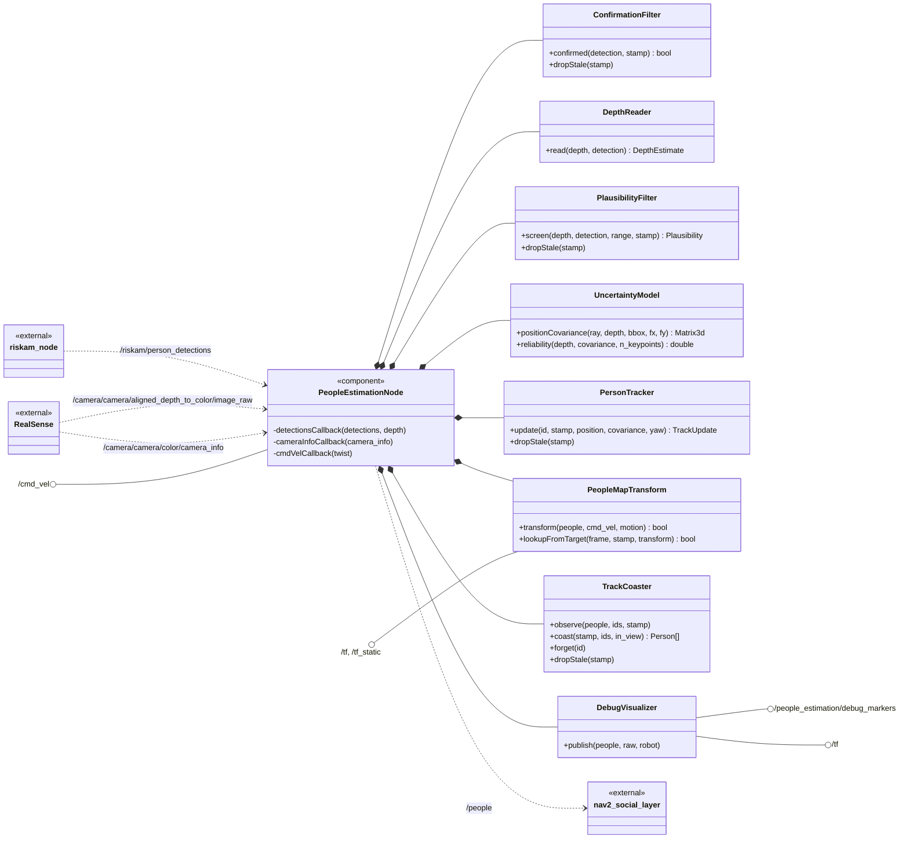
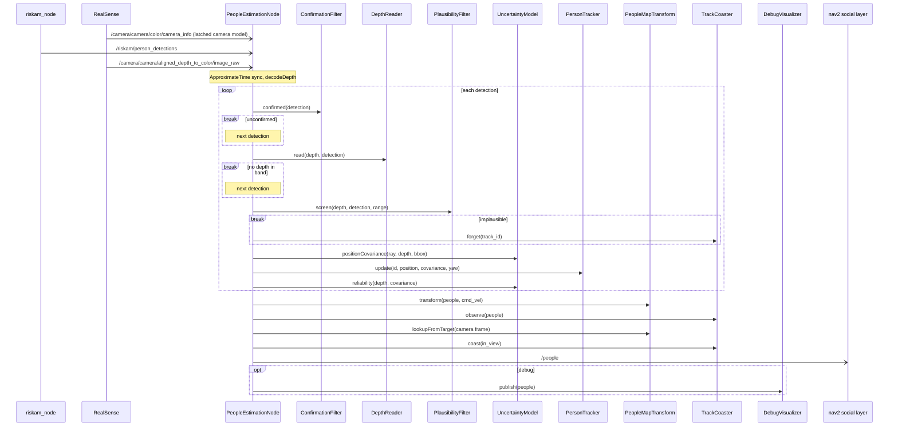

# people_velocity_estimation

## Introduction

`PeopleEstimationNode` owns one collaborator per stage below. Dashed arrows are topics exchanged
with a specific node; the lollipops are interfaces open to any.

Per synchronised detections/depth pair, the node calls them in this order:

Everything metric is measured in the **colour camera's optical frame** and re-framed into
`target_frame` (`map` by default) on the way out, so `/people` is world-fixed. Set
`target_frame: ""` to skip that and publish in the camera frame — the escape hatch for a rig
with no TF tree, not a normal setting.

The node runs the stages below in the order listed, which is also roughly their order of
importance: each one depends on the ones above it holding up.

| # | Stage | In one line |
|---|---|---|
| 1 | [Confirmation](confirmation.md) | Drop detections that have not persisted |
| 2 | [Depth read-out](depth_readout.md) | Turn a box and keypoints into a range and an anchor pixel |
| 3 | [Plausibility](plausibility.md) | Reject people printed on posters and screens |
| 4 | [Position spike filtering](position_spike_filtering.md) | Reject depth that read the background |
| 5 | [Velocity adaptive window](velocity_adaptive_window.md) | Fit a velocity over a per-track window |
| 6 | [Map transform & motion compensation](map_transform.md) | Re-frame to `target_frame`, take the robot's own motion out |
| 7 | [Coasting](coasting.md) | Carry forward a person the camera has lost |
| 8 | [Uncertainty](uncertainty.md) | Covariances and `reliability` |
| 9 | [Debug visualisation](debug_visualisation.md) | Markers for checking the geometry by eye |

For exercising the node with no robot or localisation stack, see
[Bench tooling](bench_tooling.md).
